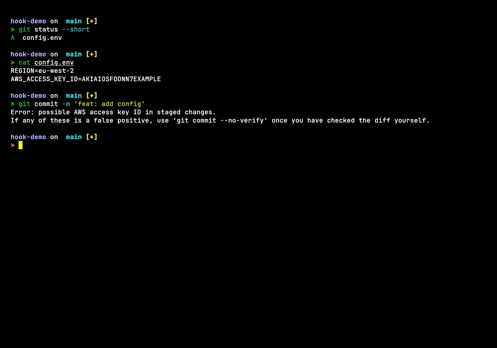

# git-hooks

This repository's global Git hooks have moved to the `git/git-hooks` folder of the dotfiles repository, where they are maintained together with the rest of the developer setup. Changes and issues are handled there.

[Open git/git-hooks in dotfiles](https://github.com/zaccesss/dotfiles/tree/main/git/git-hooks)

> [!NOTE]
> This repository is archived and read-only.

